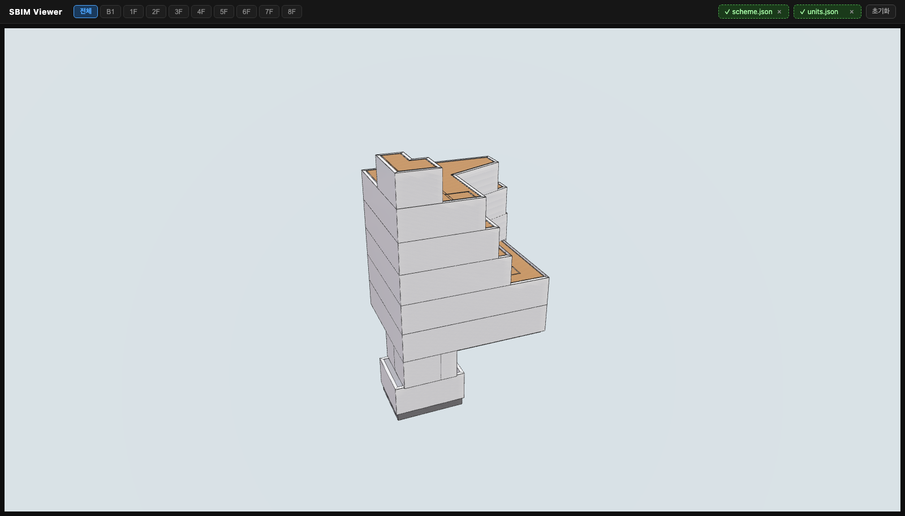
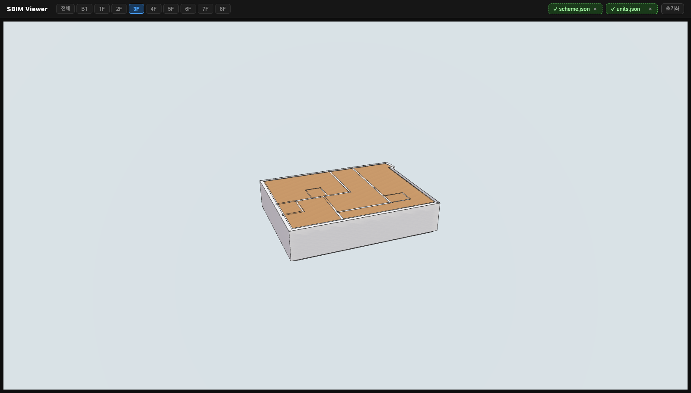

sbim
====

<p align="center">

</p>

sbim은 다세대주택 BIM 데이터를 다루는 오픈소스([Apache 2.0]) 라이브러리입니다.
타입의 정본은 Python(pydantic) 하나이고 TypeScript는 거기에 맞춰, 둘이 같은
`scheme.json`을 읽고 씁니다. 기하는 [three.js] BufferGeometry 모양의 계약으로 담고,
[IFC4] 내보내기·되읽기를 지원합니다.

건물 하나가 `scheme.json` + `units.json`으로 떨어집니다. 층별 형상은 three.js
BufferGeometry로 들어 있어 소비처의 렌더러가 그대로 그리고, `IfcTriangulatedFaceSet`으로
그대로 나가기 때문에 화면과 IFC가 어긋나지 않습니다. 세대는 `IfcSpace`에
`NetFloorArea`가 붙어 적산에 바로 씁니다.

정북 일조권 사선제한, 법정 채광면적, 주차장법 8대 특례 같은 국내 법규가 타입과
기본값에 반영돼 있습니다.

구성
----

| 이름 | 설명 | 언어 |
| --- | --- | --- |
| [python/](python) | pydantic 타입, io, 설계 옵션, 설정 오버레이, IFC 내보내기·되읽기 | Python |
| [typescript/](typescript) | 동일 타입, operations, BufferGeometry 변환 | TypeScript |
| [schema/](schema) | pydantic 에서 생성한 JSON Schema — 손으로 고치지 않는다 | JSON Schema |
| [fixtures/](fixtures) | 입력 → 정규화 `BuildOptions` 정답 쌍. 소비처 시험용, 생성물 | JSON |
| [examples/](examples) | 샘플 `scheme.json`·`units.json`, 설정 예시 | — |

`scheme.json`을 만드는 생성기는 비공개입니다. 이 저장소는 그 결과를 읽고 쓰는 쪽입니다.

정본
----

정본은 pydantic 하나입니다 — `python/seoulgaok_bim_core/options.py`의 `BuildOptions`와
`types.py`의 scheme·units 모델. 나머지는 거기서 나옵니다.

| 파일 | 무엇 |
| --- | --- |
| `schema/*.json`, `typescript/src/options.ts`, `fixtures/build_options/*.json` | 생성물. 손으로 고치지 않는다 |
| `typescript/src/types.ts` | 손으로 맞춘 TS 판. `python/tests/test_types_parity.py`가 필드 집합이 같은지 지킨다 |

옵션이나 타입을 바꿀 때는 이 순서입니다.

1. pydantic 모델을 고친다(`types.py`를 고쳤으면 `types.ts`도 손으로 맞춘다).
2. `cd python && uv run python scripts/gen_build_options.py` — 생성물을 다시 쓴다
   (`--check`는 어긋나면 1로 끝난다).
3. `pnpm -r build`로 dist를 굽는다.
4. 기본값이 바뀌거나 필드가 늘고 줄었으면 버전을 올리고 [CHANGELOG](CHANGELOG.md) 맨 위에
   한 줄 적는다. 버전은 `python/pyproject.toml`·`typescript/package.json`·
   `__version__` 셋이 같아야 한다(`test_version_sync.py`).

판은 git 태그로 찍습니다 — 머지 뒤에 사람이 `git tag v0.1.0`. 소비처는 그 태그로 고정합니다.

```jsonc
// package.json
"@seoulgaok/bim-core": "github:seoulgaok/sbim#v0.1.0&path:typescript"
```

```toml
# pyproject.toml (uv)
[tool.uv.sources]
seoulgaok-bim-core = { git = "https://github.com/seoulgaok/sbim", tag = "v0.1.0", subdirectory = "python" }
```

시작하기
--------

```bash
pip install -e "./python[ifc]"     # IFC 불필요하면 ./python
pnpm install && pnpm -r build      # TS 패키지 빌드
```

```python
import json
from seoulgaok_bim_core import generate_ifc, load_ifc

scheme = json.load(open("examples/samples/sample-medium/scheme.json"))
units  = json.load(open("examples/samples/sample-medium/units.json"))

generate_ifc(scheme, units, out_path="out.ifc")
scheme, units = load_ifc("out.ifc")
```

IFC는 건축 모델만 다룹니다. 설비(우수·오수·급수, 위생기구)는 범위 밖입니다.
되읽기는 이 라이브러리가 쓴 파일 기준이며, 재질·색과 LOD300 세그먼트 분할은
IFC에 남지 않아 복원되지 않습니다.

설정
----

사업에 따라 달라지는 값(금융 조건, 필지 선별 임계값)은 저장소에 두지 않습니다.
`examples/`의 예시 파일을 복사해 채우고 `SBIM_CONFIG`·`SBIM_SITE_FILTER`로
가리키거나 상위 경로에 두면 됩니다.

```python
from seoulgaok_bim_core import build_options, build_site_where

opts = build_options(business={"financing": {"land_loan_ltv": 0.7}})  # 인자 > 설정파일 > 기본값
where, params = build_site_where(alias="l")
```

`Financing`의 금리·LTV에는 기본값이 없습니다(`None`). 남의 협상 조건을 물려받아
사업성을 계산하는 것보다 비어 있는 편이 낫습니다. 필지 선별도 설정이 없으면
`SiteFilterNotConfigured`로 멈춥니다 — 조용히 기본값을 쓰면 전체 조회가 됩니다.

<p align="center">

</p>

라이선스
--------

[Apache 2.0]. 상업적 이용을 포함해 자유롭게 쓸 수 있습니다. 재배포 시 라이선스
사본과 [NOTICE](NOTICE)를 포함하고, 변경한 파일은 변경 사실을 표시해야 합니다.

`examples/`의 샘플은 실제 필지의 설계 결과를 익명화한 것입니다.

[Apache 2.0]: LICENSE "Apache License 2.0"
[IFC4]: https://standards.buildingsmart.org/IFC/RELEASE/IFC4/ADD2_TC1/HTML/ "IFC4 Add2 TC1"
[three.js]: https://threejs.org "three.js"
